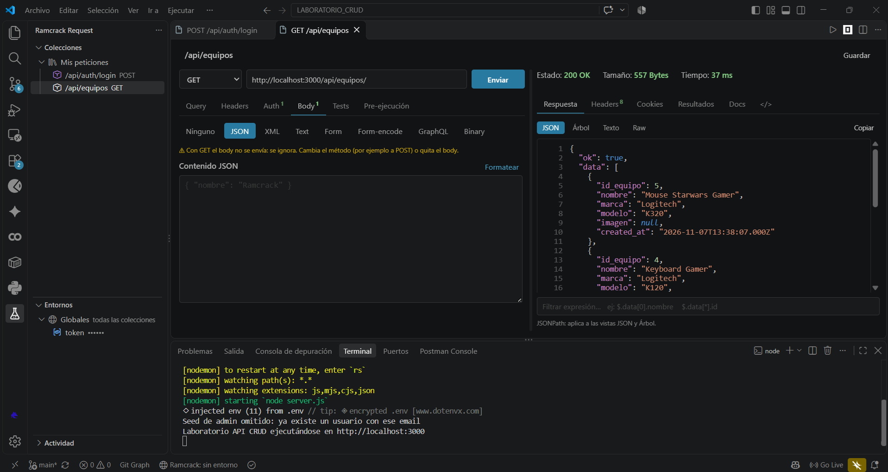
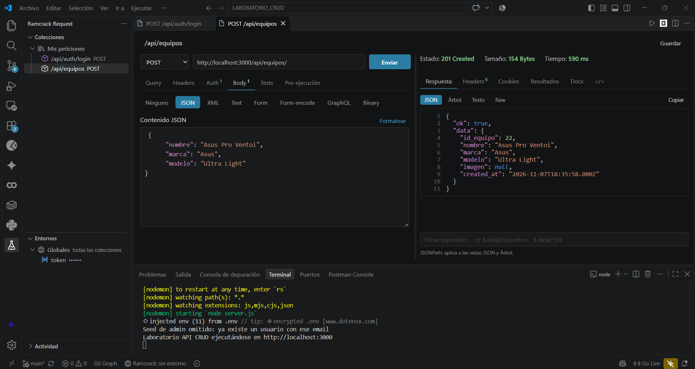
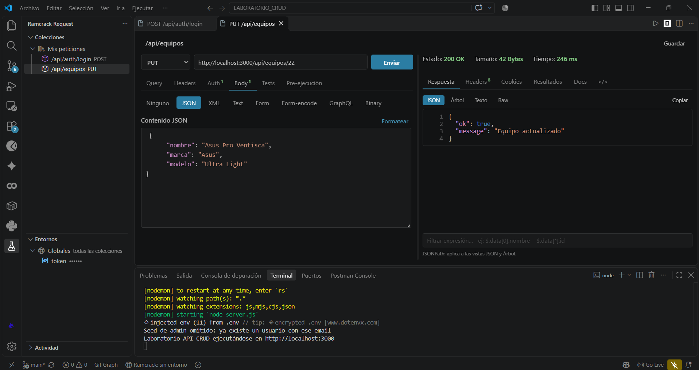
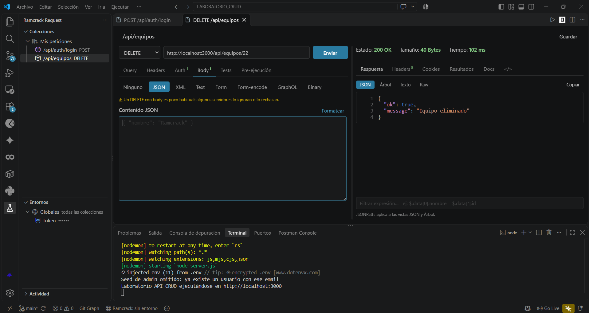
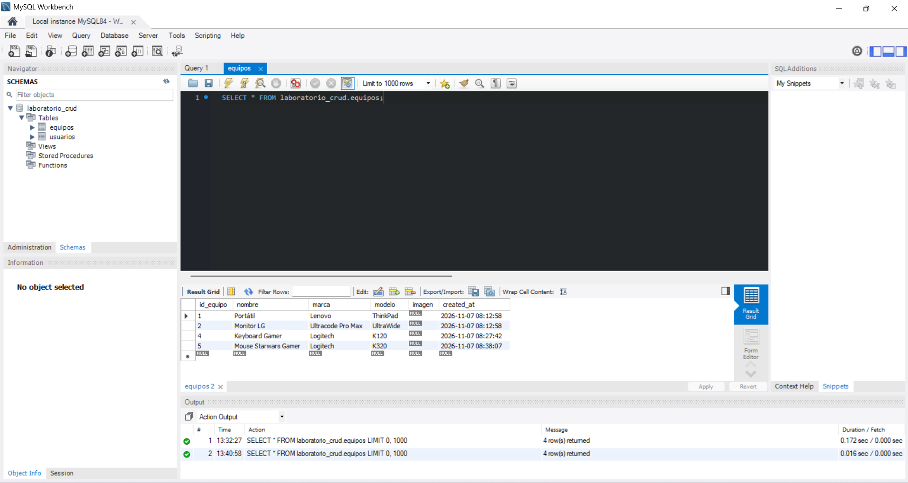

# Ramcrack Request

**Prueba tus APIs sin salir de VS Code.** Ramcrack Request es un cliente REST en español: envías peticiones HTTP (GET, POST, PUT, DELETE…) a tu backend o a cualquier API, ves la respuesta al instante y guardas las peticiones en colecciones. Gratis, sin cuentas, sin nube y sin límites. Todo se guarda en archivos JSON de tu proyecto.

Autor: **Ramcrack**

## ¿Para qué sirve?

Si programas un backend (Node, Express, Laravel, Spring, Django…) o consumes una API, antes tenías que abrir otra aplicación para probarla. Con esta extensión lo haces dentro del editor:

- **Probar tu API mientras la desarrollas:** crear un registro, listar, editar, borrar, subir una imagen.
- **Hacer login una vez y reutilizar el token** en las demás peticiones, sin copiar y pegar.
- **Comprobar que responde bien:** tests automáticos sobre el código de estado, el tiempo y el contenido del JSON.
- **Organizar y compartir tus pruebas** en carpetas, con variables por entorno (local, pruebas, producción) y guardadas en tu proyecto.
- **Pasar de otra herramienta:** importa colecciones de Postman o Thunder Client, o pega un comando `cURL`.

## Empezar en 1 minuto

1. Abre la barra lateral **Ramcrack Request** (el icono del matraz).
2. Pulsa **Nueva petición**, escribe la URL, por ejemplo `https://jsonplaceholder.typicode.com/todos/1`, y pulsa **Enviar** (`Ctrl+Enter`).
3. Para guardarla en orden, crea una **colección** y dentro una **carpeta**.

## Así se ve: un CRUD completo

Ejemplo real contra una API de prueba con Node, Express y MySQL. Todo se hace desde VS Code.

**Listar** (`GET`): la respuesta JSON llega coloreada, con estado, tamaño y tiempo. El token de acceso viene de una variable (`{{token}}`) y no está escrito en la petición.



**Crear** (`POST`): se escribe el JSON y el servidor responde `201 Created` con el registro nuevo.



**Editar** (`PUT`) y **eliminar** (`DELETE`):





**Y se comprueba en la base de datos:** los cambios hechos desde la extensión quedaron guardados.



## Características

**Petición**
- Métodos GET, POST, PUT, PATCH, DELETE, HEAD, OPTIONS, PROPFIND y CUSTOM.
- **Query** sincronizada con la URL, **Headers** con autocompletado.
- **Auth:** Basic, Bearer y API Key (en header o query).
- **Body:** JSON, XML, Text, Form (multipart con archivos), Form-encode, GraphQL y Binary.
- **Tests:** aserciones con selectores (status, tiempo, header, JSON, body) y operadores (=, ≠, contiene, >, ≥, <, ≤, existe, regex).
- **Guardar en variable:** guarda `json.token`, `header.x`, `cookie.sid` o `text` en una variable (`{{token}}` o `{{token, global}}`).
- **Pre-ejecución:** script JavaScript con `rr.setVar()` / `rr.getVar()`. El nombre antiguo `tc` sigue funcionando por compatibilidad, pero se retirará en una versión futura.
- **Docs:** documenta cada endpoint.

**Respuesta**
- Estado, tamaño y tiempo. Vistas JSON, Árbol, Texto y Raw con filtro JSONPath.
- Pestañas Headers, Cookies y Resultados de tests.
- Snippets de código: cURL, fetch, axios y Python.

**Organización**
- Colecciones con **carpetas anidadas** (arrastra y suelta, o usa "Mover a…"), entornos (con variables globales) y actividad reciente.
- **Variables del sistema:** `{{#guid}}`, `{{#name}}`, `{{#string}}`, `{{#number}}`, `{{#number, 1, 100}}`, `{{#email}}`, `{{#bool}}`, `{{#enum, a, b}}`, `{{#date}}`, `{{#date, 'YYYY-MM-DD'}}`, `{{#dateISO}}`.
- **Importar:** Postman v2.1, exportaciones de Thunder Client y comandos cURL.
- Atajos: `Ctrl+Enter` envía, `Ctrl+S` guarda.

## Instalación

**Desde el Marketplace de VS Code (recomendado):** abre **Extensiones** (`Ctrl+Shift+X`), busca **Ramcrack Request** y pulsa **Instalar**. Se actualiza sola. También por línea de comandos:

```bash
code --install-extension ramcrack.ramcrack-request
```

**Desde un archivo `.vsix`** (alternativa): descarga el instalador de la sección **Releases** del repositorio (https://github.com/Dhaniel-05/Ramcrack_Request/releases) e instálalo con **Extensiones** → menú `···` → **Instalar desde VSIX…**, o con:

```bash
code --install-extension ramcrack-request-X.Y.Z.vsix
```

Cambia `X.Y.Z` por la versión que descargaste. Las extensiones instaladas desde un `.vsix` no se actualizan solas.

En Windows, Defender o el navegador pueden marcar el `.vsix` por error (falso positivo). Guía paso a paso, con la exclusión en Defender y la verificación del archivo: [docs/INSTALACION_ESTUDIANTES.md](docs/INSTALACION_ESTUDIANTES.md).

## Uso rápido

1. Abre el icono **Ramcrack Request** (un matraz de laboratorio) en la barra lateral.
2. Crea una colección y una petición (o importa una desde Postman, Thunder Client o cURL).
3. Escribe la URL y pulsa **Enviar**.

### Flujo típico: login + token

1. Petición `POST {{baseUrl}}/auth/login` con tu body JSON.
2. En **Tests → Guardar en variable**: origen `json.token`, destino `{{token}}`.
3. En las demás peticiones: **Auth → Bearer** con `{{token}}`.

### Dónde se guardan los datos

En la carpeta `.api-request/` del proyecto abierto:
- `collections.json`: las peticiones (puedes versionarlo con git).
- `environments.json`: variables y secretos.
- `cookies.json`: las cookies de sesión que devuelven tus APIs (son credenciales; ver abajo).
- `.gitignore`: la extensión lo crea sola y deja fuera de git `environments.json`, `cookies.json` y `collections.backup.json`.

Sin carpeta abierta se usa el almacenamiento global de la extensión.

### Seguridad: no subas datos sensibles a git

> **Importante:** `.api-request/` guarda tus peticiones **tal como las escribes, en texto plano**. Si pegas un token, una contraseña, una clave de API o datos reales de clientes en una petición (Auth, Headers, Body o URL), quedarán escritos en `collections.json`. Subir esa carpeta a un repositorio, sobre todo si es público, los expone.

Buenas prácticas:

1. **Usa variables en lugar de valores reales.** Para un token de login, en la petición de login ve a **Tests → Guardar en variable** (origen `json.token`, destino `{{token}}`) y en las demás peticiones usa **Auth → Bearer** con `{{token}}`. El token se guarda en `environments.json`, no en la petición.
2. **Mantén los secretos fuera de git.** La extensión crea `.api-request/.gitignore` con `environments.json`, `cookies.json` y `collections.backup.json` (no borra ni cambia lo que tú ya hayas escrito ahí; solo añade lo que falte). Así puedes versionar `collections.json` con tu equipo. Si prefieres no subir nada, añade esta línea al `.gitignore` de tu proyecto:

   ```text
   .api-request/
   ```

   Antes de cada *commit*, comprueba que `collections.json` no contenga tokens ni contraseñas.
   Si escribes a mano un token, contraseña o API key y envías la petición, la extensión te avisa una vez por petición y te sugiere usar una variable (se puede desactivar con `apiRequest.warnPlainSecrets`).
3. **Usa credenciales de prueba**, nunca cuentas reales de producción, en las peticiones que guardes.
4. **No compartas capturas de pantalla** con tokens, contraseñas o claves visibles.
5. **Si un secreto llegó a un repositorio, considéralo comprometido:** revócalo o cámbialo de inmediato. Borrarlo del último *commit* no basta, porque queda en el historial de git.

### Cookies

Si una API responde con `Set-Cookie` (sesión por cookie), la extensión las guarda y las envía sola en las peticiones siguientes **al mismo dominio**, como un navegador: respeta dominio, ruta, caducidad (`Max-Age` / `Expires`) y `Secure`, y no las manda a otro host. También las guarda y reenvía en las **redirecciones**. Un header `Cookie` escrito a mano en la petición tiene prioridad. Se guardan en `.api-request/cookies.json` (fuera de git por el `.gitignore` automático). Para borrarlas: **Ramcrack Request: Limpiar cookies guardadas** (por dominio o todas). Se desactivan con `apiRequest.useCookies`.

> Las cookies de sesión son **credenciales**: no compartas `cookies.json`.

### Editor del body

En el body JSON, XML o texto: **Enter** mantiene la sangría (y suma un nivel después de `{` o `[`), **Tab** / **Mayús+Tab** sangran y quitan sangría (también con varias líneas seleccionadas), y en JSON se **autocierran** `{`, `[` y `"`. **Ctrl+Mayús+F** formatea el JSON. Para sacar el foco del cuadro con el teclado: **Esc** y luego **Tab**.

### Configuración

- `apiRequest.timeout`: tiempo máximo por petición (ms). Por defecto 30000.
- `apiRequest.followRedirects`: seguir redirecciones. Por defecto activo.
- `apiRequest.useCookies`: guardar y reenviar las cookies de las respuestas. Por defecto activo.
- `apiRequest.warnPlainSecrets`: avisar si una petición lleva un secreto escrito a mano. Por defecto activo.

## Desarrollo

```bash
npm install
npm run compile
npm run test:http   # pruebas del motor
# F5 en VS Code para abrir una ventana de pruebas
npm run package     # genera el instalador en release/
```

Para sacar una versión nueva (GitHub crea el Release solo): [docs/PUBLICAR.md](docs/PUBLICAR.md).

`node scripts/serve.js` sirve la interfaz del panel en `http://localhost:5173/preview` con una API de ejemplo, para diseñar sin abrir VS Code.

## Apoyar el proyecto

Ramcrack Request es libre y gratuito. Si te resulta útil y quieres ayudar a mantenerlo, puedes patrocinarlo en GitHub Sponsors: https://github.com/sponsors/Dhaniel-05

También ayuda reportar errores y proponer mejoras en [Issues](https://github.com/Dhaniel-05/Ramcrack_Request/issues).

## Marcas

Postman y Thunder Client son marcas de sus respectivos propietarios. Ramcrack Request es un proyecto independiente: no está afiliado, patrocinado ni respaldado por ellos. Esos nombres se mencionan únicamente para indicar la compatibilidad de formatos de importación.

## Licencia

MIT
